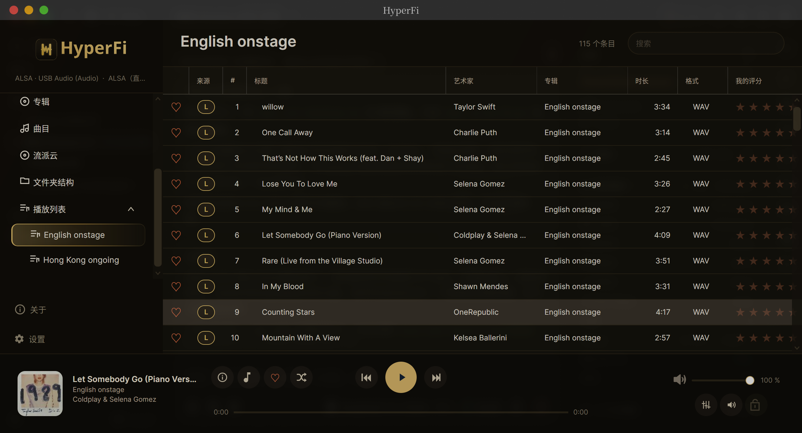

<!-- markdownlint-disable MD033 MD041 -->
<p align="center">
  
</p>

# HyperFidel

**A local-first Hi-Fi player, library, and optional home server for Windows,
Linux, and macOS.**

HyperFidel is for people who keep their music as files. It plays that library
through your own DAC, keeps the interface out of the way, and can share the same
collection with other devices through a small self-hosted server. There is no
account, no subscription, and no telemetry.

[](LICENSE)
[](https://github.com/wuuwuu26/HyperFidel/releases/latest)


**Downloads:** [latest release](https://github.com/wuuwuu26/HyperFidel/releases/latest) ·
**Wiki:** [github.com/wuuwuu26/HyperFidel/wiki](https://github.com/wuuwuu26/HyperFidel/wiki) ·
**Full reference:** [docs/FULL-FEATURE-REFERENCE.md](docs/FULL-FEATURE-REFERENCE.md)

## Highlights

- **Direct hardware playback.** Exclusive WASAPI, cwASIO, and optional Steinberg
  ASIO on Windows; direct ALSA on Linux with native DSD (DSF/DFF) and DoP
  fallback; OpenAL on macOS. Gapless playback, ReplayGain, a +6 dB PCM boost,
  and a parametric EQ with Equalizer APO / AutoEQ import.
- **DSD without conversion when the hardware supports it.** Linux opens
  `DSD_U32_BE` directly and falls back to DoP; Windows uses cwASIO or ASIO.
  WASAPI can convert DSF/DFF to PCM in real time when native DSD is unavailable.
- **One library across devices.** The desktop client merges local files with
  any connected HyperFidel Server into unified Artists, Albums, Tracks, and Folder
  views. CUE sheets, MKA chapters, smart playlists, full-text search, bulk
  favorite/rating/genre edits, and cross-device resume are built in.
- **A warm, gold interface.** Translucent surfaces over a soft gradient, a
  focused Dashboard, artwork-led browsing, and a lyrics view that scrolls
  smoothly and highlights enhanced-LRC words as they become audible.
- **Discovery that uses your own collection.** A hierarchical Genre Cloud,
  Infinite Mix, internet radio, podcasts, similar-track queues, and listening
  statistics.
- **AirPlay to a real Hi-Fi.** RAOP receiver discovery on every platform plus a
  bundled native AirPlay 2 bridge, verified with clean playback on a Sonos
  stereo pair.
- **AI and automation that stay local.** Embedded AI Chat for LM Studio, Ollama,
  or any OpenAI-compatible endpoint; an MCP server with individually toggleable
  tools; and an opt-in mobile web remote for the same LAN.
- **Private by default.** No account and no telemetry. API keys, tokens, and
  server passwords live in an encrypted per-user credential store. The complete
  interface is available in English, German, French, Spanish, Russian,
  Simplified Chinese, and Hindi.

## Screenshot



## Download

Self-contained builds bundle the .NET runtime. Pick the package for your
platform from the [latest release](https://github.com/wuuwuu26/HyperFidel/releases/latest):

| Component      | Packages                                                       |
| -------------- | -------------------------------------------------------------- |
| Windows player | `Setup.exe`, portable ZIP (Windows 10/11 x64)                  |
| Linux player   | DEB, RPM, Arch `.pkg.tar.zst`, portable tar.gz (x64 and ARM64) |
| macOS player   | PKG and portable app ZIP (Apple Silicon and Intel)             |
| HyperFidel Server | DEB and RPM (Linux x64 / ARM64, including Raspberry Pi)        |

The in-app updater verifies a signed release manifest, checks each download
digest, and installs through the native package manager on Linux.

## Supported formats

`DSF`, `DFF`, `FLAC`, `MP3`, `WAV`, `AIFF`, `M4A`, `MKA` (with chapters), `AAC`,
`OGG`, `Opus`, `WMA`, and CUE sheets that reference PCM sources. PCM decoding
uses FFmpeg. Windows and macOS locate or download FFmpeg automatically; Linux
requires `ffmpeg` and `ffprobe` on `PATH`.

## Requirements

The desktop interface bundles **Noto Serif SC** and **Noto Serif Devanagari**
under the SIL Open Font License 1.1, so it renders the same on every system
without installing fonts. The fonts are embedded in the application and add
about 36 MB to the download.

### Windows player

- Windows 10 or Windows 11, x64
- [.NET 10 SDK](https://dotnet.microsoft.com/download/dotnet/10.0) for building
- FFmpeg, downloaded automatically on first start when it is not already present
- For cwASIO: Visual Studio 2022 with the **Desktop development with C++**
  workload and an installed ASIO driver
- Optional Steinberg ASIO SDK 2.3

The MIT-licensed cwASIO sources are included under `third_party/cwasio`, so ASIO
works without the Steinberg SDK. The Steinberg SDK itself is not part of this
repository.

### Linux player

- Linux x86-64 or ARM64 with an X11 or Wayland desktop
- FFmpeg and FFprobe available on `PATH`
- ALSA runtime (`libasound.so.2`) for direct PCM, native DSD, and DoP output
- OpenAL runtime (`libopenal.so.1`) for the system-routed output profile
- `pactl` from PulseAudio or PipeWire tools for volume-key mirroring with direct
  ALSA
- A DAC/ALSA endpoint advertising `DSD_U32_BE` for native DSD, or a DoP-capable
  DAC for fallback playback

The Linux player does not build or load the Windows ASIO bridges. Native DSF and
uncompressed DFF output is sent directly through ALSA.

### macOS player

- macOS 10.15 or newer on Apple Silicon (`arm64`) or Intel (`x64`)
- FFmpeg and FFprobe from `PATH`, common package-manager locations, or HyperFidel's
  automatic per-user download
- The system OpenAL framework for PCM output
- No ASIO, cwASIO, ALSA, or native DSD support

Release builds provide self-contained PKG installers and portable app bundles.
Development builds require the .NET 10 SDK.

### HyperFidel Server

- Linux, macOS, or Windows on x64 or ARM64
- [.NET 10 SDK](https://dotnet.microsoft.com/download/dotnet/10.0) for building;
  release packages are self-contained
- FFmpeg recommended for CUE-sheet track transcoding
- No ASIO drivers or Windows audio dependencies

## Build from source

Clone the repository and build the desktop client:

```bash
git clone https://github.com/wuuwuu26/HyperFidel.git
cd HyperFidel
dotnet restore HyperFidel/HyperFidel.csproj
dotnet build HyperFidel/HyperFidel.csproj --configuration Release
dotnet run --project HyperFidel/HyperFidel.csproj
```

Create a self-contained Linux build:

```bash
dotnet restore HyperFidel/HyperFidel.csproj --runtime linux-x64
dotnet publish HyperFidel/HyperFidel.csproj --configuration Release \
  --runtime linux-x64 --self-contained true --no-restore \
  --output artifacts/HyperFidel-linux-x64
```

The same pattern works for `win-x64`, `osx-x64`, and `osx-arm64`. Windows also
provides `build.ps1`, which builds the native cwASIO bridge, optionally builds
the Steinberg bridge, and compiles the managed application. See the
[full reference](docs/FULL-FEATURE-REFERENCE.md) for SDK discovery and native
bridge options.

Run the managed tests:

```bash
dotnet test HyperFidel.Core.Tests/HyperFidel.Core.Tests.csproj
dotnet test HyperFidel.Tests/HyperFidel.Tests.csproj
dotnet test HyperFidel.Server.Tests/HyperFidel.Server.Tests.csproj
```

Build the server as a self-contained Linux binary:

```bash
dotnet publish HyperFidel.Server/HyperFidel.Server.csproj --configuration Release \
  --runtime linux-x64 --self-contained true \
  --output artifacts/HyperFidel.Server-linux-x64
```

## HyperFidel Server

`HyperFidel.Server` scans the same library directories as the desktop client and
serves them over the local network. It exposes artists, albums, tracks,
playlists, artwork, waveforms, and lyrics through a REST API, and streams audio
with authenticated URLs that work in FFmpeg and browsers. It runs as a plain
binary or a systemd service; release packages are available as DEB and RPM.

The server is optional. The desktop client works entirely offline with local
files and only connects to servers you explicitly add. See
[HyperFidel Server reference](docs/FULL-FEATURE-REFERENCE.md#hyperfidel-server) and
[HTTPS and reverse proxies](docs/SERVER-REVERSE-PROXY.md) for setup details.

## Data and privacy

HyperFidel stores player data under `%LOCALAPPDATA%\HyperFidel\` on Windows and the
operating system's local application-data directory (normally
`$HOME/.local/share/HyperFidel/`) on Linux and macOS. Set `HYPERFIDEL_DATA_DIR` to use
a different root; packaged Linux servers use `/var/lib/hyperfidel-server`.

- `settings.json` contains non-secret preferences.
- `credentials.dat` and, on Linux/macOS, `credentials.key` hold the encrypted
  Last.fm, Fanart.tv, AI Chat, HyperFidel Server, Plex, and streaming credentials.
- `library.db`, `artworks/`, `search-index/`, `waveforms/`, and the other cache
  folders hold the managed library, artwork, search data, and playback state.

Audio files are never rewritten by metadata edits, favorite/rating changes, or
library scans. The library export creates a ZIP of managed data without audio
files. There is no telemetry, and credentials are never written to
`settings.json`, logs, or documentation.

## Documentation

- [GitHub Wiki](https://github.com/wuuwuu26/HyperFidel/wiki) — end-user guides
- [Full feature and technical reference](docs/FULL-FEATURE-REFERENCE.md) — every
  feature, output profile, format behavior, and build detail
- [HTTPS and reverse proxies](docs/SERVER-REVERSE-PROXY.md) — Caddy and nginx
  examples for HyperFidel Server and authenticated MCP access
- [CHANGELOG.md](CHANGELOG.md) — shipped changes and current work
- [ROADMAP.md](ROADMAP.md) — historical implementation milestones
- [docs/WORKFLOW-TEST-COVERAGE.md](docs/WORKFLOW-TEST-COVERAGE.md) — automated
  workflow evidence and scope

## Known limitations

- Direct ALSA takes exclusive ownership of the selected card. While HyperFidel is
  playing, the matching PipeWire/PulseAudio profile is disabled so other
  applications cannot use that card; the profile is restored when playback is
  released. Volume keys are mirrored to the player through the system mixer.
- DST-compressed DFF is not supported for direct DSD output. Uncompressed
  stereo DFF and DSF are supported.
- macOS builds use OpenAL for PCM and do not provide ASIO, cwASIO, ALSA, or
  native DSD output.
- Windows Kernel Streaming is selectable but not implemented as a playback
  backend.
- Release packages for HyperFidel Server target Linux. Windows and macOS servers
  can be built from source but are not published as installers.

## License and attribution

HyperFidel is licensed under the [Apache License, Version 2.0](LICENSE). The
[NOTICE](NOTICE) file records the HyperFidel copyright, the retained Orynivo
notice, and the trademark statement for the HyperFidel name and logo.

HyperFidel is an independent derivative of
[Orynivo](https://github.com/bschlaack/Orynivo), Copyright 2026 Björn Schlaack,
which is also licensed under Apache-2.0. The original author and project are
credited in NOTICE; the Orynivo name and logo remain that project's assets.

Third-party components and their licenses are listed in
[THIRD_PARTY_NOTICES.md](THIRD_PARTY_NOTICES.md) and the `licenses/` directory.
